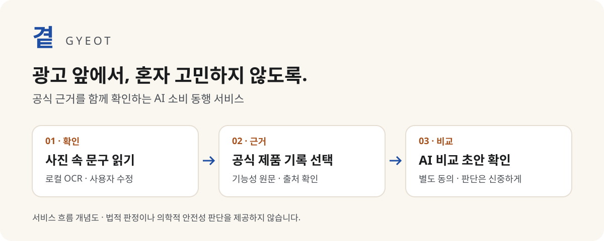
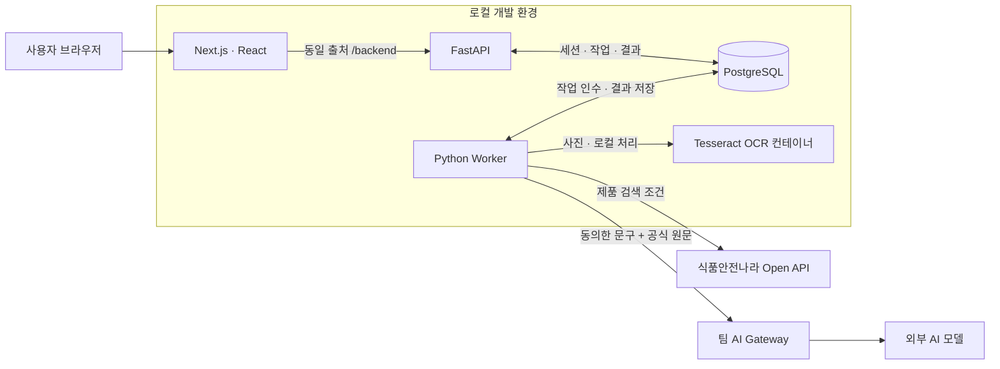

# 곁 · GYEOT

**건강식품 광고 앞에서, 공식 근거를 함께 확인하는 AI 소비 동행 서비스**



## 프로젝트 소개

곁은 고령층을 비롯한 소비자가 온라인 건강식품 광고를 그대로 믿거나 막연히 의심하는 대신, **제품의 공식 기록과 광고 문구를 나란히 확인**하도록 돕습니다.

사진에서 읽은 글자를 사용자가 수정하고, 같은 제품의 기록을 직접 선택한 뒤, 원하는 경우 AI 비교 초안을 확인합니다. AI가 구매·섭취 여부를 대신 결정하지 않습니다.

> 곁은 공식 근거를 확인하고 비교하는 도구입니다. 광고의 위법성이나 의학적 안전성을 판정하지 않습니다.

## 주요 기능

| 기능 | 제공 내용 |
| --- | --- |
| 사진에서 글자 읽기 | PNG/JPEG 업로드, 로컬 한국어·영어 OCR, 원문 확인 및 수정본 저장 |
| 공식 제품 검색 | 식품안전나라 건강기능식품·식품 품목 검색, 제품명·제조업체·번호 대조 |
| 근거 확인 | 사용자가 선택한 제품의 기능성 원문, 출처 및 조회 시각 표시 |
| AI 비교 | 별도 전송 동의 후 광고 문구와 공식 원문 비교, 인용·출력 형식 검사 |
| 진행 기록 관리 | 새로고침 복원, 작업 취소·삭제, 브라우저 세션별 접근 제한 |
| 읽기 편한 화면 | 모바일 대응, 큰 글자 설정, 단계별 확인 흐름 |

**사진 입력 → 글자 수정 → 제품·문구 확인 → 공식 기록 선택 → AI 비교 초안**

제품명·문구 자동 확정이나 개인정보 자동 가림은 아직 지원하지 않습니다. 근거가 없거나 비교가 어려운 경우에는 판단을 보류합니다.

## 시스템 구성



- 사진은 로컬 OCR에서 처리하며 외부 AI에 보내지 않습니다.
- 작업은 DB에 저장하고 별도 워커가 처리합니다. 중복 접수 및 취소·삭제 후 늦은 결과 반영을 방지합니다.
- 외부 AI 호출 실패를 자동으로 재접수하지 않습니다. 호출 한도는 금액 상한을 보장하지 않습니다.

## 기술 스택

| 영역 | 기술 |
| --- | --- |
| Web | Next.js 16 · React 19 · TypeScript · CSS · Pretendard |
| API / Worker | Python 3.12+ · FastAPI · Pydantic · psycopg 3 |
| Storage | PostgreSQL 17 · SQL 마이그레이션 |
| OCR | Tesseract `kor+eng` · Pillow · Docker |
| 외부 연동 | 식품안전나라 Open API · 팀 AI Gateway |
| 검증 / 개발 도구 | pytest · Playwright · uv · npm · Docker Compose |

## 저장소 구조

```text
modu-gyeot/
├── apps/
│   ├── web/                 # 웹 화면 및 동일 출처 API 프록시
│   └── api/
│       ├── gyeot/           # API, DB, 워커, 외부 연동 어댑터
│       ├── migrations/      # 버전 관리하는 SQL
│       └── tests/           # 격리 PostgreSQL 기반 테스트
├── services/ocr/            # 로컬 OCR 컨테이너
├── scripts/                 # 실행·브라우저 검증·공개 전 검사
├── docs/                    # 개발·구조·검증·공개 정책
│   └── assets/              # 공개용 소개 이미지
├── .github/                 # PR 템플릿
├── compose.yaml             # DB 및 OCR 실행 설정
└── .env.example             # 값이 없는 환경 변수 양식
```

## 로컬 실행

Windows PowerShell 기준입니다. **Node.js 24 LTS, Python 3.12 이상, uv, Docker Desktop**을 준비하세요.

```powershell
git clone https://github.com/junseo0im/modu-gyeot.git
Set-Location modu-gyeot
Copy-Item .env.example .env
```

[개발 가이드](docs/DEVELOPMENT.md)에 따라 `.env`에 DB 접속 정보와 API 키를 설정한 뒤 실행합니다. 이미 있는 `.env`는 덮어쓰지 마세요.

```powershell
Push-Location apps/api
uv sync --locked
Pop-Location

Push-Location apps/web
npm ci
npm run build
Pop-Location

& ./scripts/start.ps1
```

접속: **http://localhost:3000** — `127.0.0.1`이 아닌 `localhost`를 사용합니다.

## 검증 현황과 한계

- PostgreSQL 기반 테스트 **36개**, 웹 빌드·타입 검사 통과 기록이 있습니다.
- 합성 사진 → 실제 OCR → 공식 검색 → 실제 AI 비교 → 복원·삭제 흐름을 확인했습니다.
- **실제 광고 OCR 정확도, AI 의미 판단 정확도, 목표 사용자 사용성은 아직 평가가 필요합니다.**
- HTTPS·운영 모니터링·백업 검증 등 공개 운영 준비는 별도 단계입니다.

시험 조건과 비용이 발생하는 검증은 [검증 문서](docs/VALIDATION.md)를 확인하세요.

## 문서

- [개발 환경·실행·테스트](docs/DEVELOPMENT.md)
- [아키텍처·데이터 보관](docs/ARCHITECTURE.md)
- [검증 범위·다음 단계](docs/VALIDATION.md)
- [공개할 파일과 제외할 파일](docs/REPOSITORY_POLICY.md)
- [기여·커밋·PR 규칙](CONTRIBUTING.md) · [보안 안내](SECURITY.md)
- [외부 리소스와 권리 안내](THIRD_PARTY_NOTICES.md)

## 라이선스

프로젝트 자체 코드·문서·소개 개념도는 [MIT License](LICENSE)로 제공합니다. 저작권 및 라이선스 고지를 유지하면 사용·수정·재배포·상업적 이용이 가능합니다. 소프트웨어는 보증 없이 제공됩니다.

Pretendard와 외부 의존성은 각각의 라이선스를 따르며, API 데이터·광고 원본·외부 서비스 이용 권한은 MIT 라이선스에 포함되지 않습니다. 상세 내용은 [외부 리소스 안내](THIRD_PARTY_NOTICES.md)를 확인하세요.

곁은 식품의약품안전처·식품안전나라와 관련이 없는 독립 프로젝트입니다.